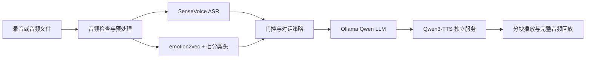

# Speech Agent · 语音情绪感知对话系统

将语音情感分类模型接入中文语音对话，支持录音、上传、转写、情绪辅助回应和语音播放。ASR、LLM、TTS 使用现成预训练模型；语音情感专家使用冻结的 emotion2vec 编码器与单独训练的分类头。

**本仓库只提供源码、配置和测试模板，不包含数据集、预训练权重、最终分类头、私人录音或历史运行结果。请自行下载资源，并自行训练或准备兼容分类头。**

## 功能

- 浏览器录音与文件上传，输入录音回放、转写展示及多轮文字对话。
- 七类语音情绪候选、分数展示，以及基于置信度、分差和熵的采纳门控。
- 按情绪线索选择回应策略；低置信度或明确自述冲突时回退到文本优先。
- 本机 ASR、Ollama LLM、独立 TTS 服务，配置式切换可选云端服务。
- 可选 TTS 加速后端、音频分块传输与浏览器连续播放。
- 模块耗时诊断、异常降级、会话隔离和三种实验模式的评测入口。

## 架构



| 模块 | 默认方案 | 是否需要自行准备 |
|---|---|---|
| ASR | SenseVoiceSmall + FSMN-VAD | 下载完整模型目录 |
| 语音编码器 | emotion2vec_plus_large，冻结 | 下载完整模型目录 |
| 情绪分类头 | 七类线性头，MCAE 与中文朗读联合训练配置 | 自行训练或准备兼容 checkpoint |
| LLM | Ollama `qwen3.5:9b` | 使用 Ollama 拉取 |
| TTS | Qwen3-TTS-12Hz-1.7B-CustomVoice | 下载模型，在独立环境运行 |

## 目录

```text
Speech_agent/
├── README.md
├── .gitignore
├── THIRD_PARTY_NOTICES.md
├── docs/                 # 下载、部署、训练、评测与发布说明
├── Emotion_Agent/        # 对话应用、网页和 TTS 服务
│   ├── configs/
│   ├── scripts/
│   ├── src/emotion_agent/
│   ├── tests/
│   └── data/             # 仅版本管理手写示例和未填录音模板
└── Speech_model/         # 语音专家的数据准备、训练、评估与推理
    ├── configs/
    ├── src/
    └── tests/
```

文件夹名称可自定；文档中的命令从同时包含 `Emotion_Agent/` 和 `Speech_model/` 的仓库根目录执行。

## 快速开始

参考环境：Windows Server 2019、NVIDIA RTX 3090；主应用 Python 3.10，TTS 独立 Python 3.12。其他硬件和系统需自行验证。

1. 按 [Windows 部署](docs/DEPLOYMENT_WINDOWS.md)建立环境。
2. 按 [数据与模型](docs/DATA_AND_MODELS.md)自行下载预训练模型；情感分类头按 [训练复现](docs/TRAINING.md)生成。
3. 启动 Ollama、独立 TTS 服务，再启动应用：

```bat
python Emotion_Agent/scripts/run_demo.py doctor --probe
python Emotion_Agent/scripts/run_demo.py serve
```

浏览器打开 `http://127.0.0.1:8000`。

还没有分类头时，可先验证基础语音链路：

```bat
python Emotion_Agent/scripts/run_demo.py --config Emotion_Agent/configs/no_speech_expert.yaml serve
```

该配置不进行语音情绪识别。ASR、LLM、TTS 仍需准备；纯文字且关闭语音回复只需要 LLM。默认完整配置不会将缺失权重伪装成成功识别。

## 测试与评测

不下载模型也可以运行应用协议和网页测试，依赖安装见部署文档：

```bat
python Emotion_Agent/scripts/run_tests.py
node --test Emotion_Agent/tests/web.test.cjs
python -m unittest discover -s Speech_model/tests -p "test_*.py"
```

测试使用替身模型与合成特征，不能代替真实模型验收。整理时的验证记录见 [发布验证](docs/VALIDATION.md)。仓库不预填模型性能成绩，详见 [评测说明](docs/EVALUATION.md)。

## 范围与限制

当前按轮处理，LLM 完成回复后再进行 TTS 分块生成；不包含实时全双工或打断。单卡同一时间限制一轮推理，没有多人排队系统。情绪结果是声学分类线索，不是对用户内心状态的确定判断；门控阈值需要在独立开发集上验证。

训练区分冻结编码器与训练分类头；本项目没有从头训练 ASR、LLM 或 TTS。语音专家的跨说话人、跨数据集及自然对话效果需要分别评估。默认不会在本地失败后自动调用付费云端服务。

## 文档与资源

- [环境与 Windows 部署](docs/DEPLOYMENT_WINDOWS.md)
- [数据集和模型下载、放置位置](docs/DATA_AND_MODELS.md)
- [训练与复现](docs/TRAINING.md)
- [系统架构与策略边界](Emotion_Agent/docs/architecture.md)
- [TTS 加速与流式播放](Emotion_Agent/docs/tts_streaming_windows.md)
- [评测与消融](docs/EVALUATION.md)
- [上传 GitHub 前的检查及命令](docs/PUBLISHING.md)
- [第三方来源和许可证说明](THIRD_PARTY_NOTICES.md)

源码许可证尚未指定，由维护者在正式发布前选择；第三方数据、模型和依赖遵循各自条款。本仓库不重新分发这些资源。
